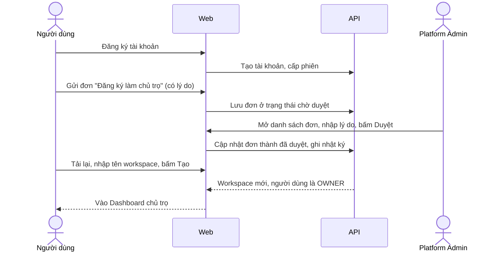
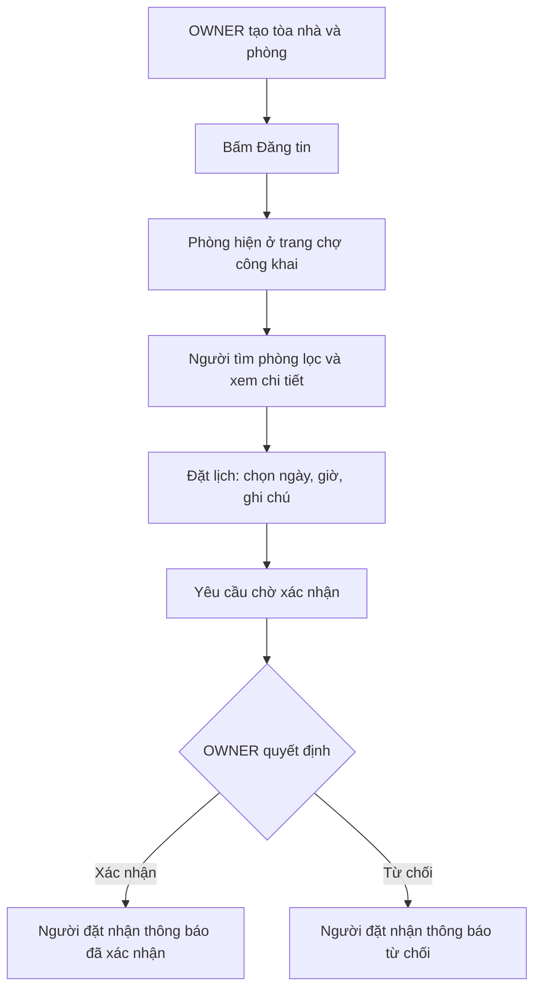
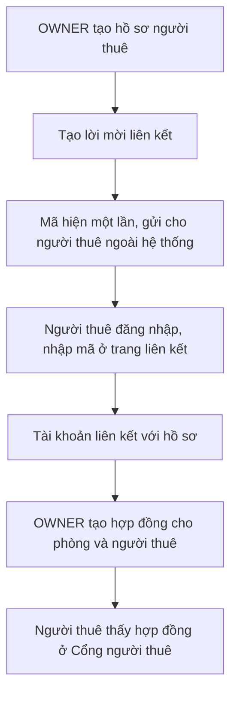
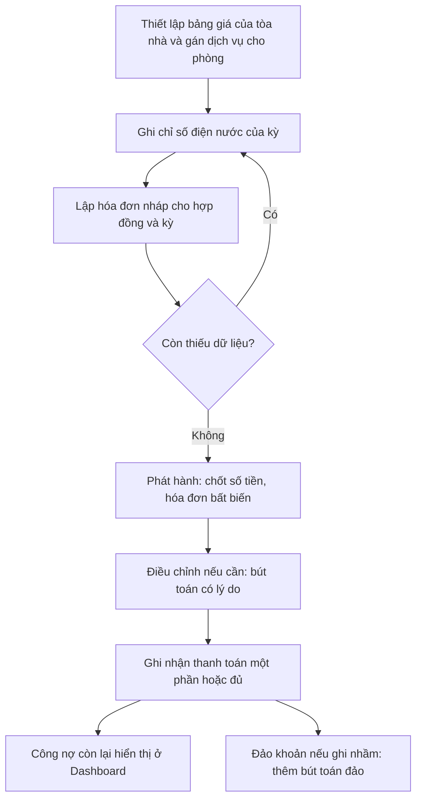
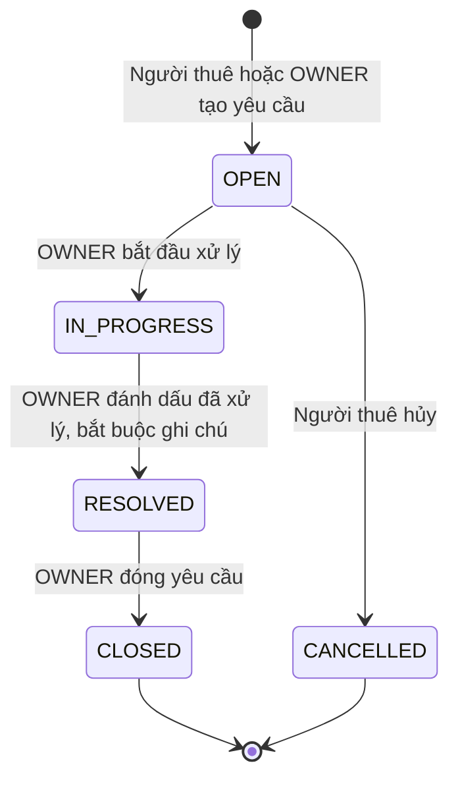
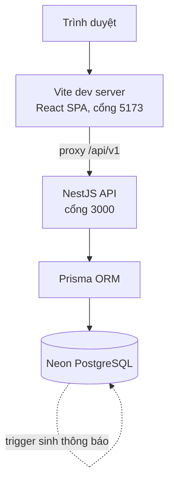
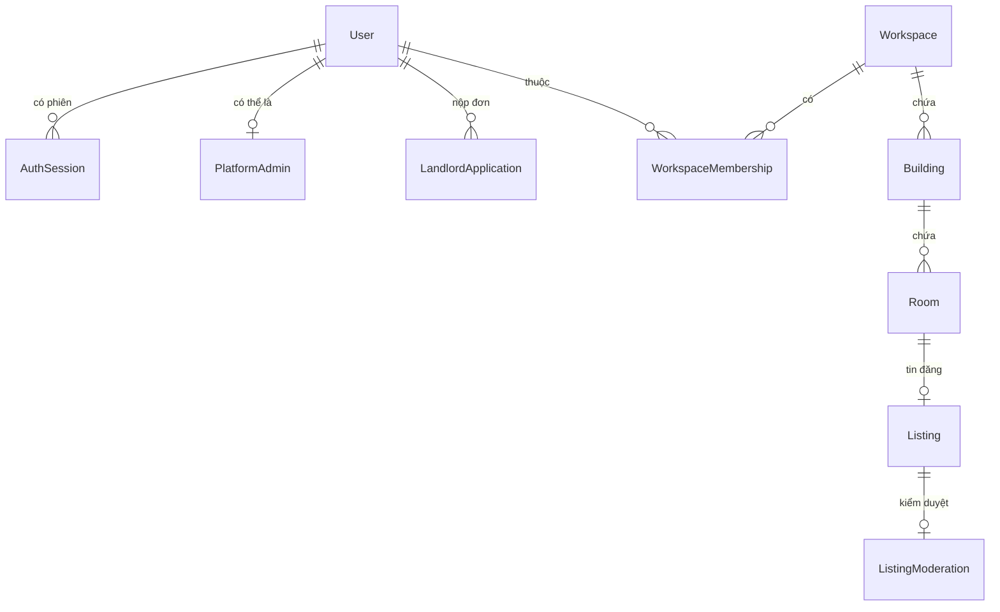
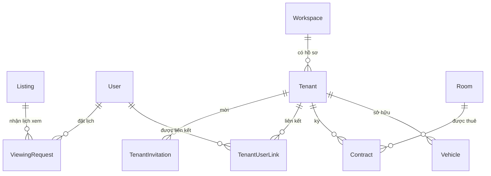
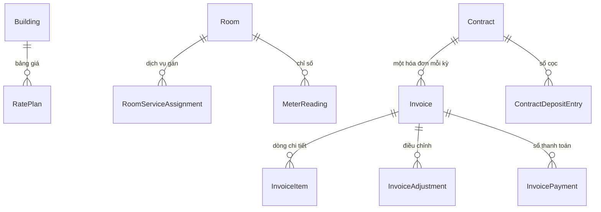
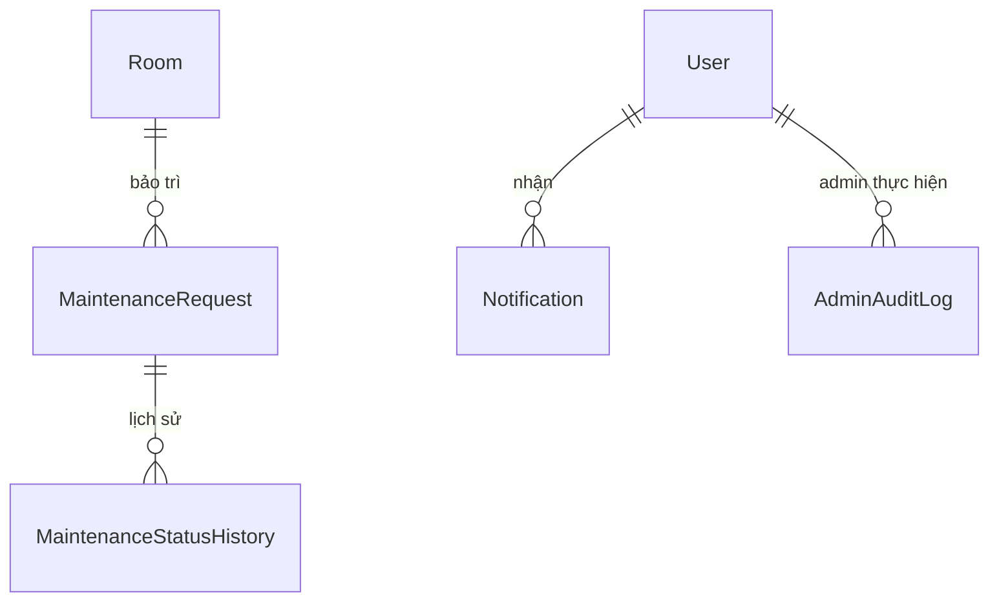

# Apartment-app V1 — Tài liệu tổng quan

> **Soạn ngày 16/10/2026**, đối chiếu với source tại nhánh `feature/backend-buildings` (commit `10dccdb`). Tài liệu mô tả những gì **có trong code**; những gì chưa được kiểm chứng được ghi rõ ở từng mục và tổng hợp ở [mục I](#i-giới-hạn-và-việc-chưa-hoàn-thành).

## Mục lục

- [A. Giới thiệu dự án](#a-giới-thiệu-dự-án)
- [B. Các vai trò người dùng](#b-các-vai-trò-người-dùng)
- [C. Toàn bộ tính năng V1](#c-toàn-bộ-tính-năng-v1)
- [D. Các luồng nghiệp vụ từ đầu đến cuối](#d-các-luồng-nghiệp-vụ-từ-đầu-đến-cuối)
- [E. Công nghệ sử dụng](#e-công-nghệ-sử-dụng)
- [F. Kiến trúc hệ thống](#f-kiến-trúc-hệ-thống)
- [G. Database và mô hình dữ liệu](#g-database-và-mô-hình-dữ-liệu)
- [H. Testing và mức độ hoàn thiện](#h-testing-và-mức-độ-hoàn-thiện)
- [I. Giới hạn và việc chưa hoàn thành](#i-giới-hạn-và-việc-chưa-hoàn-thành)
- [J. Hướng dẫn chạy dự án](#j-hướng-dẫn-chạy-dự-án)
- [K. Tổng kết](#k-tổng-kết)

**Cách đọc nhãn trạng thái.** Mỗi nhóm tính năng trong mục C có một dòng trạng thái:

| Nhãn                       | Ý nghĩa                                                                         |
| -------------------------- | ------------------------------------------------------------------------------- |
| **Đã kiểm chứng REAL**     | Đã chạy thật qua trình duyệt/HTTP với backend và database thật (môi trường DEV) |
| **Có code + test tự động** | Backend và frontend có code, có test tự động, nhưng chưa có lần chạy REAL riêng |
| **Chỉ mock**               | Chỉ chạy được ở chế độ demo dữ liệu giả                                         |
| **Hoãn**                   | Quyết định chưa làm trong V1                                                    |
| **Chưa kiểm chứng**        | Có code nhưng chưa có bằng chứng chạy đúng                                      |

---

## A. Giới thiệu dự án

### Apartment-app là gì?

Apartment-app (tên mã trong code: _Rental Platform_) là một **ứng dụng web quản lý nhà trọ / phòng cho thuê**. Một nơi duy nhất để:

- **Chủ trọ** quản lý tòa nhà, phòng, người thuê, hợp đồng, điện nước, hóa đơn, thu tiền và bảo trì.
- **Người tìm phòng** xem tin đăng công khai và đặt lịch xem phòng.
- **Người thuê** theo dõi hợp đồng, hóa đơn, tiền cọc của mình và gửi yêu cầu bảo trì.
- **Quản trị viên nền tảng** duyệt chủ trọ mới, kiểm duyệt tin đăng và xem nhật ký quản trị.

### Vấn đề thực tế

Nhiều chủ trọ quy mô nhỏ và vừa vẫn quản lý bằng sổ tay, Excel và tin nhắn. Hậu quả quen thuộc: nhầm chỉ số điện nước, hóa đơn sửa tay không dấu vết, tiền thu và tiền cọc lẫn vào nhau, hợp đồng chồng lấn, yêu cầu sửa chữa bị bỏ sót. Ngược lại, người thuê khó biết mình còn nợ bao nhiêu và vì sao. Apartment-app đưa các việc này vào một hệ thống có quy tắc rõ ràng, có lịch sử không sửa được cho các số liệu tài chính.

### Mục tiêu của phiên bản V1

V1 tập trung vào **vòng đời cho thuê trọn vẹn**, từ tin đăng đến thu tiền:

1. Đăng tin phòng và nhận yêu cầu xem phòng.
2. Ký hợp đồng và gắn tài khoản người thuê với hồ sơ thuê.
3. Tính hóa đơn hằng tháng từ hợp đồng, bảng giá và chỉ số điện nước.
4. Ghi nhận thanh toán, tiền cọc, và theo dõi công nợ.
5. Xử lý bảo trì.
6. Quản trị nền tảng ở mức tối thiểu cần thiết.

### Đối tượng sử dụng

Bốn nhóm người dùng (chi tiết ở [mục B](#b-các-vai-trò-người-dùng)): người tìm phòng, chủ trọ, người thuê, quản trị viên nền tảng.

### Phạm vi hiện tại và giới hạn sản phẩm

V1 **cố tình hẹp** ở một số điểm (xác nhận từ code):

- **Chủ trọ chỉ có một vai trò: OWNER.** Vai trò MANAGER/STAFF đã bị gỡ khỏi runtime; cơ sở dữ liệu còn chặn tạo mới.
- **Không có cổng thanh toán trực tuyến.** Thanh toán do chủ trọ ghi nhận thủ công (tiền mặt hoặc chuyển khoản). Người thuê không tự gửi thanh toán trong ứng dụng. Trong source không có tích hợp ví/cổng thanh toán.
- **Không có báo cáo (Reports) trong V1.** Menu đã ẩn; đường dẫn cũ tự chuyển về Dashboard.
- **Ảnh phòng chỉ nhận đường dẫn URL**, không có chức năng tải ảnh lên.
- **Không thấy xuất PDF/Excel** trong source.

Tài liệu này **không** tuyên bố V1 đã sẵn sàng cho môi trường production (xem [mục I](#i-giới-hạn-và-việc-chưa-hoàn-thành) và [mục K](#k-tổng-kết)).

---

## B. Các vai trò người dùng

Hệ thống không lưu "vai trò toàn cục" cho từng tài khoản. **Quyền của một người được backend tính từ quan hệ thật trong database** mỗi khi frontend hỏi (`GET /users/me/capabilities`), gồm: có sở hữu workspace nào không, có liên kết người thuê nào không, có phải Platform Admin không.

| Vai trò                      | Là ai                                              | Cách có được vai trò                                                                       | Khu vực giao diện                         |
| ---------------------------- | -------------------------------------------------- | ------------------------------------------------------------------------------------------ | ----------------------------------------- |
| **Khách**                    | Chưa đăng nhập                                     | Không cần                                                                                  | Xem tin đăng, chi tiết phòng              |
| **Người tìm phòng** (Seeker) | Tài khoản đã đăng ký, chưa có quyền gì khác        | Đăng ký tài khoản                                                                          | Đặt lịch xem, lịch xem của tôi, thông báo |
| **Chủ trọ** (OWNER)          | Người sở hữu một workspace                         | Đăng ký làm chủ trọ → Admin duyệt → tạo workspace                                          | Không gian quản lý `/w/<id>/…`            |
| **Người thuê** (Tenant)      | Tài khoản gắn với một hồ sơ người thuê của chủ trọ | Nhập **mã mời** do chủ trọ tạo                                                             | Cổng người thuê `/tenant/…`               |
| **Platform Admin**           | Quản trị nền tảng                                  | Có dòng trong bảng `platform_admins` (cấp ở mức database; ứng dụng không có chức năng cấp) | Khu quản trị `/admin/…`                   |

### Một tài khoản có nhiều vai trò được không?

**Được.** Các khu vực không loại trừ nhau. Ví dụ một chủ trọ có thể đồng thời là người thuê ở workspace của chủ trọ khác. Trong giao diện có thanh chuyển khu vực (Tìm phòng trọ / Chủ trọ / Cổng người thuê / Quản trị), chỉ hiện những khu vực tài khoản thực sự có. Sau khi đăng nhập, hệ thống đưa người dùng tới trang chủ theo thứ tự ưu tiên: Admin → Chủ trọ → Người thuê → Tìm phòng.

Trường hợp chủ trọ + người thuê (hai workspace khác nhau) đã được kiểm tra qua trình duyệt thật: cả hai khu vực hoạt động và dữ liệu không lẫn sang nhau.

### Quyền truy cập và giới hạn dữ liệu

- **Cô lập theo workspace.** Mọi API quản lý nằm dưới `/workspaces/<id>/…`. Người không phải OWNER của workspace nhận lỗi _"không tìm thấy"_ (404) thay vì _"bị cấm"_, để không lộ việc workspace có tồn tại.
- **Người thuê chỉ thấy dữ liệu của mình** qua các API `…/me` (hợp đồng, hóa đơn, bảo trì), được lọc theo liên kết tài khoản–hồ sơ còn hiệu lực. Hóa đơn nháp không hiển thị cho người thuê.
- **Platform Admin** chỉ vào được các API `/admin/…`; người khác nhận 403. Admin **không** tự động có quyền sửa phòng, hợp đồng hay hóa đơn của chủ trọ.
- **Một số ràng buộc đáng biết:** mỗi người chỉ sở hữu tối đa **một workspace đang hoạt động**; Admin không thể duyệt đơn của chính mình.

---

## C. Toàn bộ tính năng V1

> Một số thuật ngữ: **Workspace** là "không gian làm việc" của một chủ trọ, chứa mọi dữ liệu của họ. **Listing** là tin đăng công khai của một phòng. **Kỳ hóa đơn** là một tháng lịch (múi giờ Việt Nam). **Ledger/sổ cái** là danh sách bút toán chỉ được thêm, không được sửa.

### 1. Xác thực: đăng ký, đăng nhập, phiên làm việc

- **Ai dùng:** mọi người.
- **Làm được gì:** đăng ký (email + mật khẩu 12–128 ký tự), đăng nhập, đăng xuất, đăng xuất mọi thiết bị, xem/sửa tên hiển thị; quên/đặt lại mật khẩu.
- **Cách hoạt động:** sau đăng nhập, trình duyệt nhận **access token** (hết hạn sau 10 phút, giữ trong bộ nhớ trang) và một **refresh token** trong cookie `HttpOnly`. Khi access token hết hạn, frontend tự xin token mới (mỗi lần chỉ một yêu cầu refresh dù có nhiều lỗi 401 cùng lúc). Mỗi lần refresh, refresh token được **xoay vòng**; dùng lại token cũ bị coi là tấn công và thu hồi cả chuỗi phiên.
- **Lưu qua backend thật:** có.
- **Giới hạn:** đăng ký và đăng nhập có giới hạn tần suất trong bộ nhớ của tiến trình API (mặc định 5 lần đăng ký/15 phút/IP). Gửi email đặt lại mật khẩu mặc định **tắt** (xem mục I).
- **Trạng thái:** đăng ký/đăng nhập/làm mới/đăng xuất **Đã kiểm chứng REAL**; quên/đặt lại mật khẩu **Có code + test tự động, email thật chưa kiểm chứng**.

### 2. Đăng ký làm chủ trọ và Admin duyệt

- **Ai dùng:** tài khoản bình thường (nộp đơn), Platform Admin (duyệt).
- **Quy trình:** người dùng viết lý do và nộp đơn → Admin xem danh sách đơn → **duyệt hoặc từ chối, bắt buộc có lý do** → đơn được duyệt cho phép **tạo workspace đầu tiên**. Duyệt đơn không tự tạo workspace.
- **Quy tắc chống lạm dụng:** mỗi người chỉ có một đơn đang chờ; tối đa 3 đơn trong 365 ngày; sau khi bị từ chối phải chờ 30 ngày; Admin không duyệt được đơn của chính mình. Quyết định được ghi vào nhật ký quản trị.
- **Lưu qua backend thật:** có.
- **Trạng thái:** **Đã kiểm chứng REAL** (nộp đơn, duyệt, từ chối, tạo workspace qua giao diện thật).

### 3. Workspace và tòa nhà

- **Ai dùng:** OWNER.
- **Làm được gì:** tạo workspace (tên); lưu trữ và khôi phục workspace (có hộp thoại xác nhận, **không phải xóa**); tạo, sửa, lưu trữ, khôi phục **tòa nhà** (tên, địa chỉ, phường/quận/thành phố, tọa độ tùy chọn).
- **Giới hạn:** mỗi người một workspace hoạt động; khôi phục workspace cũ bị chặn khi đã có workspace hoạt động khác. Cơ sở dữ liệu cấm xóa cứng workspace/tòa nhà và chặn lưu trữ tòa nhà còn hợp đồng đang hiệu lực.
- **Trạng thái:** **Đã kiểm chứng REAL**.

### 4. Quản lý phòng và trạng thái phòng

- **Ai dùng:** OWNER.
- **Làm được gì:** tạo/sửa phòng (mã phòng tự chuẩn hóa chữ hoa, diện tích, giá thuê, số người tối đa, mô tả); gắn **tiện ích** (do chủ trọ tự định nghĩa theo workspace); thêm **ảnh bằng URL**; lưu trữ/khôi phục.
- **Trạng thái phòng:** `VACANT` (trống), `OCCUPIED` (đang thuê), `UNAVAILABLE` (tạm ngưng), `ARCHIVED` (lưu trữ). Chủ trọ chỉ tự đặt được _Trống_ hoặc _Tạm ngưng_; **"Đang thuê" do hệ thống tự đặt** khi một hợp đồng đã đến ngày bắt đầu. Hợp đồng bắt đầu ở tương lai không làm phòng "Đang thuê".
- **Trạng thái:** **Đã kiểm chứng REAL** (tạo phòng, trạng thái theo hợp đồng); gắn tiện ích/ảnh qua giao diện: **Có code + test tự động**.

### 5. Marketplace: tìm kiếm, lọc, xem chi tiết

- **Ai dùng:** mọi người, kể cả khách chưa đăng nhập.
- **Điều kiện một phòng hiện công khai:** chủ trọ đã bật đăng tin, phòng đang **Trống**, chưa có hợp đồng đã bắt đầu, workspace và tòa nhà còn hoạt động, và tin **không bị Admin ẩn**.
- **Tìm/lọc:** theo thành phố, quận, phường, khoảng giá, tiện ích; có phân trang. Chi tiết tin hiển thị ảnh, thông tin phòng, địa chỉ và nút **"Xem vị trí & chỉ đường"**, mở Google Maps ở tab mới bằng địa chỉ (không nhúng bản đồ, không dùng Maps API).
- **Trạng thái:** **Đã kiểm chứng REAL** (đăng tin → xuất hiện ở `/rooms`; ẩn → 404 công khai; khôi phục → hiện lại).

### 6. Đặt lịch xem phòng

- **Ai dùng:** người tìm phòng (đặt, hủy), OWNER (xác nhận, từ chối).
- **Quy trình:** người đã đăng nhập chọn ngày (trong 30 ngày tới), khung giờ và ghi chú → yêu cầu `PENDING` → OWNER **xác nhận** (kèm ghi chú, chỉ khi giờ hẹn còn ở tương lai và phòng vẫn đủ điều kiện) hoặc **từ chối**. Người đặt có thể hủy. Các bên nhận thông báo.
- **Trạng thái:** **Đã kiểm chứng REAL**.

### 7. Hồ sơ người thuê, mã mời, liên kết OWNER–Tenant

- **Ai dùng:** OWNER (tạo hồ sơ, mã mời, thu hồi), Tenant (nhập mã).
- **Quy trình:** OWNER tạo **hồ sơ người thuê** (họ tên, điện thoại, email…) → bấm _Tạo lời mời liên kết_ → hệ thống sinh **mã mời 43 ký tự**, hiển thị **đúng một lần**, chỉ lưu dạng băm, hết hạn sau 7 ngày, dùng được một lần → người thuê đăng nhập, nhập mã ở `/link-tenant` → tài khoản được liên kết, và quyền thay đổi ngay. OWNER có thể **thu hồi** liên kết.
- **Nguyên tắc quan trọng:** hệ thống **không** tự liên kết theo số điện thoại hay email; chỉ liên kết khi người thuê chứng minh bằng mã mời.
- **Giới hạn:** backend có cơ chế _người thuê tự yêu cầu liên kết theo ID hồ sơ_ để OWNER duyệt, nhưng form tạo yêu cầu này bị **hoãn** ở frontend (người thuê chỉ xem lịch sử yêu cầu).
- **Trạng thái:** mã mời **Đã kiểm chứng REAL**; yêu cầu liên kết theo ID **Hoãn**.

### 8. Hợp đồng thuê: hiệu lực và kết thúc

- **Ai dùng:** OWNER tạo/sửa/kết thúc; Tenant xem hợp đồng của mình.
- **Dữ liệu:** phòng, người thuê, ngày bắt đầu, ngày kết thúc (**tính bao gồm**), tiền thuê tháng, ghi chú. Một phòng **không thể có hai hợp đồng chồng thời gian**; điều này được bảo đảm cả ở tầng cơ sở dữ liệu.
- **Vòng đời:** chỉ có hai trạng thái lưu (`ACTIVE`, `ENDED`); **pha hiệu lực** được suy ra từ ngày (múi giờ Việt Nam), không có tác vụ nền:

| Pha              | Ý nghĩa                                                                   |
| ---------------- | ------------------------------------------------------------------------- |
| Chưa có hiệu lực | Đã tạo nhưng chưa đến ngày bắt đầu (phòng vẫn Trống, chỉ được **hủy**)    |
| Đang hiệu lực    | Trong khoảng bắt đầu–kết thúc                                             |
| Quá hạn          | Đã quá ngày kết thúc nhưng chủ trọ chưa kết thúc (hệ thống không tự đóng) |
| Đã kết thúc      | Chủ trọ kết thúc với ngày thực tế                                         |
| Đã hủy           | Hủy trước ngày bắt đầu; kỳ thuê đã đăng ký được giữ làm lịch sử           |

- **Phương tiện:** OWNER ghi nhận xe của người thuê (biển số chuẩn hóa) và có thể ngừng sử dụng, không xóa.
- **Trạng thái:** hợp đồng hiện tại/tương lai/hủy **Đã kiểm chứng REAL**; sửa hợp đồng và quản lý xe qua giao diện **Có code + test tự động** (xe đã kiểm chứng REAL ở mức API).

### 9. Bảng giá, dịch vụ, chỉ số điện nước

- **Ai dùng:** OWNER.
- **Bảng giá (theo tòa nhà):** mỗi dịch vụ có mã, loại (điện, nước, wifi, rác, giữ xe, khác), đơn vị tính (kWh, m³, phòng, người, xe, cố định), đơn giá và **ngày áp dụng**. Đổi giá = tạo **phiên bản mới** và đóng phiên bản cũ; ngừng áp dụng bằng ngày kết thúc loại trừ.
- **Dịch vụ áp dụng cho phòng:** chỉ những dịch vụ được **gán cho phòng** mới được tính vào hóa đơn.
- **Chỉ số điện nước:** mỗi phòng, mỗi loại, mỗi kỳ có một chỉ số. Lần ghi đầu của phòng nhập số cũ; các kỳ sau số cũ tự nối từ kỳ trước. Sửa chỉ số cần **lý do** và được lưu lịch sử (không ghi đè).
- **Trạng thái:** **Đã kiểm chứng REAL**.

### 10. Hóa đơn: lập, phát hành, điều chỉnh

- **Ai dùng:** OWNER lập/phát hành/điều chỉnh; Tenant xem hóa đơn đã phát hành.
- **Quy trình:** chọn hợp đồng và kỳ → hệ thống tạo **bản nháp**, tự tính từ tiền thuê (theo số ngày hợp đồng nằm trong kỳ), bảng giá, chỉ số, dịch vụ gán cho phòng và xe. Nếu thiếu dữ liệu (ví dụ chưa có chỉ số điện), bản nháp liệt kê **mục còn thiếu** và chưa phát hành được. Có thể sửa thông tin và **tính lại**, hoặc xóa bản nháp.
- **Phát hành:** chốt số tiền, làm tròn **về 1 đồng (làm tròn nửa lên)**; từ đó hóa đơn **bất biến**. Mỗi hợp đồng chỉ có một hóa đơn cho mỗi kỳ.
- **Điều chỉnh:** số tiền khác 0 (dương: thu thêm; âm: giảm), **bắt buộc lý do**, có khóa chống gửi trùng; sửa sai bằng một điều chỉnh mới tham chiếu điều chỉnh cũ. Không được giảm tổng xuống dưới số đã thu.
- **Trạng thái:** **Đã kiểm chứng REAL** (nháp → phát hành → điều chỉnh).

### 11. Thanh toán và hoàn tác

- **Ai dùng:** OWNER ghi nhận; Tenant xem sổ thanh toán.
- **Làm được gì:** ghi nhận thanh toán **một phần hoặc đủ** (tiền mặt/chuyển khoản, số tiền đồng nguyên, thời điểm nhận không ở tương lai, ghi chú); có nút _Thu đủ số còn lại_. Tổng thanh toán **không được vượt** số phải thu.
- **Hoàn tác:** thanh toán sai được **đảo** bằng một bút toán đảo có lý do; bút toán gốc giữ nguyên. Cơ sở dữ liệu từ chối sửa/xóa bút toán.
- **Tính chất kỹ thuật:** mỗi thao tác tài chính mang một **khóa idempotency** (gửi lặp cùng khóa trả lại kết quả cũ thay vì ghi hai lần).
- **Trạng thái thanh toán hóa đơn** (suy ra): Chưa thanh toán / Thanh toán một phần / Đã thanh toán — tách biệt với trạng thái hóa đơn (Nháp / Đã phát hành).
- **Trạng thái:** **Đã kiểm chứng REAL**.

### 12. Tiền cọc và lịch sử biến động

- **Ai dùng:** OWNER ghi nhận; Tenant xem (chỉ đọc).
- **Sổ cọc tách riêng** khỏi tiền thuê và không tính vào doanh thu. Loại giao dịch: **Thu cọc**, **Khấu trừ** (bắt buộc lý do và nội dung liên quan), **Hoàn cọc** (cần hình thức, lý do, mã chuyển khoản/biên nhận), và **Đảo**. Số dư là thu − khấu trừ − hoàn, **không được âm**: hoàn vượt số dư bị từ chối.
- **Trạng thái:** **Đã kiểm chứng REAL**.

### 13. Yêu cầu bảo trì

- **Ai dùng:** Tenant tạo/hủy; OWNER tạo/sửa/xử lý.
- **Quy trình:** người thuê gửi yêu cầu (tiêu đề, mô tả, mức ưu tiên Thấp → Khẩn cấp) từ **hợp đồng đang hiệu lực**; OWNER chuyển trạng thái **tuần tự một chiều**: Mới tiếp nhận → Đang xử lý → Đã xử lý (**bắt buộc ghi chú**) → Đã đóng. Người thuê có thể hủy khi còn "Mới tiếp nhận". Mọi bước lưu vào lịch sử.
- **Giới hạn:** V1 **không giao người phụ trách** và không có bình luận.
- **Trạng thái:** **Đã kiểm chứng REAL**.

### 14. Thông báo và Dashboard

- **Thông báo:** bảy loại (yêu cầu/xác nhận/từ chối/hủy lịch xem; yêu cầu bảo trì mới và đổi trạng thái; hóa đơn phát hành). Chúng được **sinh bởi trigger của PostgreSQL** khi dữ liệu thay đổi, có số chưa đọc, đánh dấu từng cái hoặc tất cả.
- **Dashboard (OWNER):** số liệu từ backend, lọc theo tòa nhà và kỳ: số phòng theo trạng thái; hợp đồng (đang hiệu lực, sắp bắt đầu, quá hạn, sắp hết hạn 30 ngày); hóa đơn theo trạng thái; tổng đã lập và đã thu trong kỳ; công nợ còn lại và quá hạn; số yêu cầu bảo trì theo trạng thái.
- **Trạng thái:** **Đã kiểm chứng REAL** (số liệu dashboard khớp dữ liệu vừa tạo).

### 15. Platform Admin

- **Đơn chủ trọ:** xem, lọc, duyệt/từ chối kèm lý do.
- **Người dùng:** danh sách, chi tiết, **khóa/mở khóa tài khoản** kèm lý do (khóa thu hồi các phiên đăng nhập; Admin không khóa được chính mình hoặc một Platform Admin khác).
- **Tin đăng:** xem toàn bộ, **ẩn/khôi phục** tin kèm lý do (không xóa phòng hay dữ liệu gốc).
- **Nhật ký (audit log):** xem lịch sử thao tác quản trị, lọc theo đối tượng (Người dùng/Tin đăng) và sự kiện. Nhật ký không sửa được.
- **Trạng thái:** duyệt/từ chối, ẩn/khôi phục tin, nhật ký **Đã kiểm chứng REAL**; **khóa/mở khóa tài khoản: Có code + test tự động, chưa chạy REAL** (chưa được duyệt để thử nghiệm trên dữ liệu thật).

### 16. Các chức năng khác có trong code

- Tài khoản cá nhân (`/account`), cập nhật tên hiển thị.
- Quên mật khẩu / đặt lại mật khẩu (xem mục 1).
- Chọn workspace, lưu trữ/khôi phục workspace.
- Chế độ **demo mock** cho giao diện (xem mục E).
- Trang giới thiệu/trợ giúp tĩnh, trang lỗi 403/404/500/offline.

---

## D. Các luồng nghiệp vụ từ đầu đến cuối

### Luồng 1 — Từ tài khoản mới đến workspace đầu tiên



Chưa được duyệt thì giao diện không có chức năng tạo workspace; backend cũng từ chối (`LANDLORD_APPLICATION_REQUIRED`).

### Luồng 2 — Từ tòa nhà đến lịch xem phòng



### Luồng 3 — Mời người thuê và lập hợp đồng



Hợp đồng có thể được tạo trước khi liên kết tài khoản; liên kết chỉ quyết định người thuê có xem được dữ liệu của mình trên ứng dụng hay không.

### Luồng 4 — Điện nước, hóa đơn, thanh toán, công nợ



Hóa đơn phát hành tạo thông báo cho người thuê. Người thuê xem hóa đơn, sổ thanh toán và điều chỉnh nhưng không tự ghi thanh toán.

### Luồng 5 — Bảo trì



### Luồng 6 — Quản trị và kiểm toán

Platform Admin: duyệt/từ chối đơn chủ trọ → ẩn một tin đăng vi phạm (bắt buộc lý do) → tin biến mất khỏi chợ công khai (người dùng thấy 404) và không nhận thêm lịch xem → khôi phục khi đã xử lý → mọi thao tác nằm trong **Nhật ký hoạt động**, lọc theo đối tượng và sự kiện. Chủ trọ không tự khôi phục được tin bị Admin ẩn.

---

## E. Công nghệ sử dụng

Thông tin dưới đây lấy từ `package.json` và source, không từ tài liệu thiết kế cũ.

| Lớp            | Công nghệ                                                                                                                                                         |
| -------------- | ----------------------------------------------------------------------------------------------------------------------------------------------------------------- |
| Monorepo       | npm workspaces: `apps/api`, `apps/web`, `packages/shared`; Node.js 24, npm 11                                                                                     |
| Frontend       | React 18, TypeScript, Vite 6, React Router 6, TanStack Query 5, React Hook Form + Zod, lucide-react; **không dùng thư viện UI/CSS framework ngoài** (CSS tự viết) |
| Gọi API        | Lớp `httpClient` tự viết dựa trên `fetch`, không dùng Axios                                                                                                       |
| Backend        | NestJS 11 (Express), TypeScript, class-validator/class-transformer, Swagger                                                                                       |
| Database / ORM | PostgreSQL (Neon), Prisma ORM 7.10 với driver adapter `pg`                                                                                                        |
| Bảo mật        | Argon2id (băm mật khẩu), JWT HS256 (jsonwebtoken), Helmet, CORS allowlist                                                                                         |
| Gói dùng chung | `@rental/shared`: kiểu dữ liệu request/response, mã lỗi và vài hàm nghiệp vụ dùng cả hai phía (ví dụ tính pha hợp đồng)                                           |
| Test           | Jest + ts-jest + Supertest (backend); Vitest + Testing Library (frontend); Playwright (trình duyệt)                                                               |
| Chất lượng     | ESLint, Prettier, Husky + lint-staged, GitHub Actions                                                                                                             |

> **Lưu ý về tài liệu nội bộ cũ.** `PROJECT_CONTEXT.md` và một số tài liệu trong `docs/` còn ghi React 19, Axios hoặc vai trò MANAGER/STAFF. Các điểm đó đã lỗi thời so với source; tài liệu này đã đối chiếu lại với source.

### Mock và REAL

Frontend có hai cách lấy dữ liệu, chọn bằng biến môi trường `VITE_USE_MOCK_API`:

|                         | **Mock** (`true`)                                           | **REAL** (mặc định, `false`)       |
| ----------------------- | ----------------------------------------------------------- | ---------------------------------- |
| Nguồn dữ liệu           | Dữ liệu giả trong `src/mocks`, nằm trong bộ nhớ trình duyệt | Backend NestJS qua proxy `/api/v1` |
| Cần backend và database | Không                                                       | Có                                 |
| Tải lại trang           | Mất thay đổi                                                | Dữ liệu lưu trong database         |
| Giao diện               | Có banner "Chế độ demo"                                     | Không có banner                    |

Mỗi nhóm tính năng của frontend có một "adapter": một bản gọi API thật và một bản mock, hoán đổi theo biến trên. Nhờ vậy giao diện chạy được độc lập để demo và để chạy test trình duyệt nhanh.

---

## F. Kiến trúc hệ thống



Ở môi trường phát triển, Vite chuyển tiếp mọi yêu cầu `/api/v1` sang NestJS nên trình duyệt chỉ nói chuyện với **một origin**; cookie refresh vì vậy cùng site với trang web.

### Cấu trúc thư mục

```text
apps/
  api/        NestJS: modules/ (auth, workspaces, buildings, rooms, marketplace,
              tenants, contracts, vehicles, rates, meters, invoices, deposits,
              maintenance, notifications, dashboard, admin, onboarding, users, health)
              prisma/ (schema.prisma và 27 migration)
  web/        React: pages/, features/ (theo nhóm nghiệp vụ), components/, layouts/,
              services/http/, mocks/, e2e/ (Playwright; e2e/real là bộ test chạy thật)
packages/
  shared/     Kiểu dữ liệu và mã lỗi dùng chung giữa web và API
docs/         Tài liệu thiết kế, hợp đồng API, trạng thái dự án
```

### Backend theo lớp

Mỗi module backend đi theo chuỗi **Controller → Service → Repository → Prisma → PostgreSQL**: controller nhận yêu cầu và kiểm tra dữ liệu vào; service giữ quy tắc nghiệp vụ; repository làm việc với database trong transaction. Mức cô lập `Serializable` được dùng ở nhiều repository cho các thao tác dễ xung đột (hợp đồng, bảng giá, hóa đơn, thanh toán, sổ cọc…).

### Frontend gọi API thế nào

- `httpClient` gắn `Authorization: Bearer <access token>` và gửi kèm cookie; token nằm **trong bộ nhớ**, không ghi vào `localStorage`/cookie đọc được bằng JS (`localStorage` chỉ nhớ workspace dùng gần nhất).
- Các thao tác thay đổi dữ liệu mang header `X-CSRF-Protection: 1`.
- Khi nhận 401, frontend refresh một lần rồi thử lại.
- Dữ liệu được cache và làm mới bằng TanStack Query; quyền của người dùng lấy từ `GET /users/me/capabilities`, **không** suy từ email hay dữ liệu lưu ở trình duyệt.

### Xác thực và phân quyền

- **Access token** HS256, sống 10 phút; **refresh token** ngẫu nhiên (opaque), chỉ lưu dạng băm trong database, xoay vòng mỗi lần dùng, phát hiện dùng lại, chuỗi phiên hết hạn tuyệt đối sau 30 ngày (theo tài liệu thiết kế P01).
- Cookie refresh: `HttpOnly`, `SameSite=Lax`, và `Secure` khi chạy `production`.
- **Chống CSRF/Origin:** mọi yêu cầu thay đổi dữ liệu (POST/PATCH/PUT/DELETE) trên các API của hệ thống cần header `X-CSRF-Protection` đúng giá trị và `Origin` nằm trong danh sách cho phép; ngược lại bị từ chối (403). Điều này đã được kiểm tra bằng yêu cầu thật ở các API xác thực.
- **Phân quyền:** guard theo workspace (chỉ OWNER), guard Platform Admin, và các API `…/me` lọc theo liên kết người thuê.
- **Củng cố HTTP:** Helmet, CORS chỉ cho origin khai báo, `ValidationPipe` nghiêm ngặt (loại bỏ và từ chối trường lạ).

### Cô lập workspace và bảo vệ dữ liệu ở tầng database

Ngoài kiểm tra trong code, nhiều quy tắc được **cưỡng chế bằng chính PostgreSQL** (trigger và ràng buộc trong migration), nên kể cả lỗi ứng dụng cũng khó phá vỡ chúng:

- Bút toán thanh toán, sổ cọc, điều chỉnh hóa đơn, lịch sử bảo trì, lịch sử chỉnh chỉ số, nhật ký quản trị: **chỉ thêm, không sửa/xóa**.
- Hóa đơn đã phát hành và các dòng của nó: **bất biến**.
- Workspace, tòa nhà, phòng, hợp đồng, người thuê, xe, bảng giá: **cấm xóa cứng**.
- Hợp đồng của cùng một phòng **không được chồng thời gian** (ràng buộc loại trừ).
- Không thể chèn mới hoặc đổi vai trò sang MANAGER/STAFF.
- Phòng đang có hợp đồng hiệu lực không đổi trạng thái tùy ý; tòa nhà có hợp đồng hiệu lực không lưu trữ được.
- Thông báo được sinh bởi trigger.

---

## G. Database và mô hình dữ liệu

Cơ sở dữ liệu là **PostgreSQL trên Neon**; schema khai báo trong `apps/api/prisma/schema.prisma` (khoảng 1.000 dòng, 27 migration). Tên dưới đây là tên model trong Prisma.

Mô hình dữ liệu được chia thành bốn sơ đồ cho dễ đọc (một số thực thể như `User` và `Room` xuất hiện ở nhiều sơ đồ).

**1. Tài khoản, workspace và tài sản**



**2. Marketplace, người thuê và hợp đồng**



**3. Giá, hóa đơn và tiền**



**4. Vận hành và quản trị**



### Các nhóm thực thể chính

| Nhóm            | Model chính                                                                             | Điểm đáng chú ý                                                                                           |
| --------------- | --------------------------------------------------------------------------------------- | --------------------------------------------------------------------------------------------------------- |
| Tài khoản       | `User`, `AuthSession`, `PasswordResetToken`, `PlatformAdmin`                            | Phiên lưu băm refresh token; Platform Admin là một bảng riêng                                             |
| Onboarding      | `LandlordApplication`                                                                   | Một đơn chờ duyệt mỗi người; lưu người quyết định, thời điểm, lý do                                       |
| Workspace       | `Workspace`, `WorkspaceMembership`                                                      | Enum vai trò còn giá trị MANAGER/STAFF (dữ liệu lịch sử) nhưng V1 chỉ cho phép OWNER                      |
| Tài sản         | `Building`, `Room`, `RoomImage`, `Amenity`, `RoomAmenity`                               | Trạng thái `ACTIVE/ARCHIVED` và `VACANT/OCCUPIED/UNAVAILABLE/ARCHIVED`; ảnh lưu URL                       |
| Marketplace     | `Listing`, `ListingModeration`, `ViewingRequest`                                        | Mỗi phòng tối đa một tin; kiểm duyệt của Admin lưu riêng, không đụng dữ liệu phòng                        |
| Người thuê      | `Tenant`, `TenantInvitation`, `TenantLinkRequest`, `TenantUserLink`                     | Mã mời lưu băm; liên kết có thời điểm thu hồi                                                             |
| Hợp đồng        | `Contract`, `Vehicle`                                                                   | Chỉ `ACTIVE/ENDED` được lưu; pha hiệu lực suy ra                                                          |
| Giá và chỉ số   | `RatePlan`, `RoomServiceAssignment`, `MeterReading`, `MeterReadingAdjustment`           | Bảng giá có phiên bản theo ngày; chỉ số duy nhất theo phòng-loại-kỳ                                       |
| Hóa đơn và tiền | `Invoice`, `InvoiceItem`, `InvoiceAdjustment`, `InvoicePayment`, `ContractDepositEntry` | Một hóa đơn mỗi hợp đồng-kỳ; khóa idempotency duy nhất trên từng sổ; bút toán đảo tham chiếu bút toán gốc |
| Vận hành        | `MaintenanceRequest`, `MaintenanceStatusHistory`, `Notification`                        | Thông báo có khóa chống trùng theo người nhận                                                             |
| Quản trị        | `AdminAuditLog`                                                                         | Chỉ thêm; ghi người thực hiện, hành động, đối tượng, lý do                                                |

Số tiền được lưu dạng **thập phân (Decimal)**, không dùng số thực; ngày hợp đồng là **ngày lịch** theo múi giờ `Asia/Ho_Chi_Minh`, còn thời điểm sự kiện lưu UTC.

---

## H. Testing và mức độ hoàn thiện

### Những gì có sẵn trong repository

| Loại                                | Số lượng (đếm từ source)                             | Chạy ở đâu                                   |
| ----------------------------------- | ---------------------------------------------------- | -------------------------------------------- |
| Unit test backend (`*.spec.ts`)     | 51 file                                              | Jest, trong CI                               |
| Test API tích hợp (`*.api-spec.ts`) | 10 file                                              | Jest + Supertest, trong CI ở chế độ không DB |
| Test frontend (Vitest)              | 32 file                                              | Trong CI                                     |
| Playwright chế độ mock              | 35 kịch bản × 2 thiết bị (desktop, mobile)           | Trong CI                                     |
| Playwright **REAL**                 | 3 READ, 1 onboarding, 18 bước API, 15 bước UI-driven | **Chỉ chạy thủ công**, không nằm trong CI    |

CI (GitHub Actions, workflow _Quality_) chạy: lint, kiểm tra định dạng, typecheck, kiểm tra schema Prisma, test đơn vị, test API không database, build, và test trình duyệt mock.

Bộ test REAL ghi dữ liệu vào Neon DEV nên có **cổng chặn riêng**: chỉ chạy khi đặt biến phê duyệt và tài khoản Admin test, kiểm tra trước đúng database/TLS/số migration/tình trạng API, và dừng nếu thiếu điều kiện nào. Mỗi lần chạy dùng dữ liệu có mã run riêng, dọn bằng các chuyển trạng thái hợp lệ của sản phẩm (kết thúc hợp đồng, đảo bút toán, lưu trữ…), **không xóa lịch sử**.

### Kết quả theo báo cáo nghiệm thu FE-11

> **Lưu ý về nguồn số liệu.** Các con số dưới đây lấy từ **báo cáo nghiệm thu FE-11** do các lần chạy trước đó thực hiện. **Lần soạn tài liệu này không chạy lại bất kỳ test nào.** Mã nguồn của các bộ test có trong repository; kết quả chạy chi tiết (manifest) của các lần REAL nằm ở thư mục cục bộ `apps/web/.real-smoke/` và **không được commit** (đã loại khỏi git). Hai manifest của các lần PASS đã được dựng lại từ database, không phải bản gốc.

| Hạng mục                                 | Kết quả theo báo cáo                                              |
| ---------------------------------------- | ----------------------------------------------------------------- |
| REAL READ                                | 6/6 PASS (3 test × desktop và mobile)                             |
| REAL API WRITE                           | 22/22 PASS                                                        |
| REAL UI-driven                           | 19/19 PASS (15 bước thao tác trên giao diện, 3 READ, 1 setup API) |
| Vitest                                   | 444/444 PASS                                                      |
| Playwright mock (đợt scoped sau khi sửa) | 8/8 PASS                                                          |
| Playwright mock toàn bộ (mốc trước đó)   | 68/68 PASS                                                        |
| Typecheck, ESLint, build                 | PASS                                                              |

Về con số 68: mốc đó có trước khi thêm một kịch bản kiểm tra việc gỡ Reports; file hiện tại có 35 kịch bản (70 lượt chạy). Toàn bộ 70 lượt **chưa được chạy lại** sau khi thêm kịch bản đó, nên con số 68/68 chỉ mô tả mốc cũ.

### Lỗi frontend được phát hiện nhờ kiểm thử REAL

Khi chạy luồng thanh toán trên giao diện thật, bước _"Thu đủ số còn lại"_ đôi khi bị backend từ chối vì giao diện dùng số còn phải thu **chưa kịp làm mới** sau thanh toán một phần. Đã sửa để thao tác chỉ hoàn tất sau khi dữ liệu mới tải xong, kèm test đơn vị mới. Hành vi từ chối của backend là đúng; lỗi nằm ở frontend.

---

## I. Giới hạn và việc chưa hoàn thành

**Đã quyết định hoãn / ngoài phạm vi V1**

- **Reports**: chưa có trong V1 vì backend chưa có API báo cáo; menu ẩn, đường dẫn cũ chuyển về Dashboard.
- **Yêu cầu liên kết bằng ID hồ sơ (UUID)**: form phía người thuê bị hoãn; chỉ dùng mã mời.
- **Vai trò MANAGER/STAFF**, thanh toán trực tuyến/đối soát ngân hàng tự động, tải ảnh lên, xuất PDF/Excel: không có trong V1.
- **Google Maps** chỉ là liên kết _Directions_ theo địa chỉ, không phải bản đồ tương tác tích hợp.

**Chưa có bằng chứng kiểm chứng**

- Một số thao tác ghi qua giao diện chưa có kiểm thử REAL: sửa hợp đồng, sửa hồ sơ người thuê, quản lý xe, chỉnh sửa chỉ số/bảng giá ngoài các bước đã chạy.
- **Mobile** chỉ có kiểm tra READ; luồng ghi trên mobile chưa được kiểm chứng toàn diện (kịch bản mock có chạy trên giả lập mobile).
- **Email quên mật khẩu thật** chưa được kiểm chứng (nhà cung cấp email mặc định tắt).
- **Khóa/mở khóa tài khoản** chưa được thử trên dữ liệu thật.
- Không có bằng chứng về **hiệu năng, tải đồng thời lớn, kiểm thử bảo mật chuyên sâu, trợ năng (accessibility)**.
- Chưa có PostgreSQL kiểm thử tách biệt để chạy đầy đủ bộ test ràng buộc/đồng thời (theo `docs/CURRENT_STATUS.md`).

**Rủi ro kỹ thuật đã biết**

- Lỗi "làm mới dữ liệu chưa kịp" đã sửa ở hook thanh toán, nhưng **cùng kiểu mã** (làm mới dữ liệu theo kiểu "bắn rồi quên") vẫn còn ở một số hook khác như hóa đơn, tiền cọc, người thuê, tòa nhà/phòng, bảo trì, quản trị. Chưa có bằng chứng lỗi ở các hook này.
- Bộ giới hạn tần suất đăng nhập/đăng ký nằm **trong bộ nhớ một tiến trình**, không chia sẻ giữa nhiều bản chạy và mất khi khởi động lại.
- Cấp quyền Platform Admin là thao tác thủ công trong database.
- Một số tài liệu nội bộ (`docs/CURRENT_STATUS.md`, `PROJECT_CONTEXT.md`) chưa cập nhật kịp so với source.

**Về production**: chưa có bằng chứng (triển khai, giám sát, sao lưu, kiểm thử tải, rà soát bảo mật độc lập) để kết luận hệ thống sẵn sàng production. Tài liệu này không đưa lộ trình tương lai vì chưa có lộ trình nào được phê duyệt.

---

## J. Hướng dẫn chạy dự án

Hướng dẫn từng bước chi tiết hơn nằm ở `docs/HUONG_DAN_CHAY_THU.md`. Dưới đây là phần cốt lõi.

### Yêu cầu

- Git, **Node.js 24.x**, **npm 11**.

### Cài đặt

```bash
git clone <địa-chỉ-repository>
cd <thư-mục-repository>
npm ci
npm run build -w @rental/shared
```

`npm ci` cũng tự sinh Prisma Client, không cần kết nối database.

### Cách dễ nhất: chế độ mock (không cần backend, không cần bí mật)

```bash
# Git Bash / macOS / Linux
VITE_USE_MOCK_API=true npm run dev -w @rental/web
```

```powershell
# PowerShell
$env:VITE_USE_MOCK_API='true'
npm run dev -w @rental/web
```

Mở `http://localhost:5173`. Có banner "Chế độ demo". Các tài khoản demo được khai báo trong `apps/web/src/mocks/data/users.ts` (mật khẩu demo ghi ngay trong file đó, chỉ dùng cho mock).

### Chế độ REAL (cần database PostgreSQL riêng)

1. Tạo `apps/api/.env` từ `apps/api/.env.example`: bật `DATABASE_ENABLED` và `AUTH_ENABLED`, điền chuỗi kết nối database **của bạn**, và các khóa ký token do bạn tự sinh ngẫu nhiên. **Không commit file này.**
2. Áp schema bằng các migration trong `apps/api/prisma/migrations`.
3. Chạy API:

```bash
cd apps/api
node --no-experimental-strip-types --require ts-node/register src/main.ts
```

4. Chạy web với `VITE_USE_MOCK_API=false` (và `VITE_API_PROXY_TARGET` trỏ tới API, mặc định `http://127.0.0.1:3000`).

Hai lưu ý thực tế: (1) các script `prisma:migrate:*` của repository đang **khóa cứng** vào database phát triển của chủ dự án như một lớp an toàn, nên người ngoài cần chỉnh script đó hoặc dùng lệnh Prisma trực tiếp với database của mình; (2) lệnh `npm run dev` ở thư mục gốc dùng `node --watch`, từng bị khởi động lại liên tục trên một máy Windows, nên ví dụ trên dùng lệnh chạy trực tiếp. Người chỉ muốn xem sản phẩm nên dùng **chế độ mock**.

Bạn **không cần** (và không được cấp) quyền vào database phát triển của chủ dự án để dùng tài liệu này.

### Kiểm tra API

```bash
curl http://127.0.0.1:3000/api/v1/health         # API còn sống
curl http://127.0.0.1:3000/api/v1/health/ready   # {"status":"ok","database":"up"} khi nối được DB
```

Khi bật `SWAGGER_ENABLED`, tài liệu API tương tác ở `http://127.0.0.1:3000/api/docs`.

### Các màn hình chính

| Khu vực    | Đường dẫn                                                                                                                                                                          |
| ---------- | ---------------------------------------------------------------------------------------------------------------------------------------------------------------------------------- |
| Công khai  | `/` (trang chủ), `/rooms` (danh sách), `/rooms/<id>` (chi tiết), `/login`, `/register`                                                                                             |
| Người dùng | `/my-viewings`, `/notifications`, `/account`, `/link-tenant`, `/workspaces/select`                                                                                                 |
| Chủ trọ    | `/w/<workspace>/dashboard`, `/buildings`, `/rooms`, `/viewings`, `/tenants`, `/contracts`, `/vehicles`, `/rates`, `/meters`, `/invoices`, `/payments`, `/deposits`, `/maintenance` |
| Người thuê | `/tenant` (và `/tenant/contracts`, `/tenant/invoices`, `/tenant/maintenance`)                                                                                                      |
| Quản trị   | `/admin` (và `/admin/applications`, `/admin/users`, `/admin/listings`, `/admin/audit-logs`)                                                                                        |

### Chạy test

```bash
npm run lint
npm run typecheck
npm test                          # backend + frontend (không cần database)
npm run test:e2e -w @rental/web   # Playwright chế độ mock (cần: npx playwright install chromium)
```

Bộ test REAL (`apps/web/playwright.real.config.ts`) **không** dành cho người ngoài: nó ghi vào database phát triển và có cổng phê duyệt riêng.

---

## K. Tổng kết

### Apartment-app V1 hiện làm được gì

Một vòng đời cho thuê nhà trọ có thể đi hết bằng giao diện thật: nộp đơn làm chủ trọ và được duyệt → tạo workspace, tòa nhà, phòng → đăng tin và nhận yêu cầu xem phòng → mời người thuê, ký hợp đồng (hiện tại hoặc tương lai) → thiết lập giá, ghi điện nước, lập và phát hành hóa đơn, điều chỉnh → ghi nhận thanh toán, tiền cọc và hoàn tác → xử lý bảo trì → theo dõi bằng thông báo và Dashboard → Platform Admin kiểm duyệt và xem nhật ký.

### Điểm kỹ thuật đáng chú ý

- **Sổ cái tài chính chỉ thêm, hóa đơn phát hành bất biến**, được cưỡng chế bằng trigger của PostgreSQL chứ không chỉ bằng code ứng dụng.
- **Quyền tính từ dữ liệu thật** (capabilities do backend trả), hỗ trợ một tài khoản nhiều vai trò, cô lập dữ liệu theo workspace và theo liên kết người thuê.
- **Idempotency** cho thao tác tiền: gửi lặp không ghi hai lần.
- **Pha hiệu lực hợp đồng suy ra từ ngày**, không cần tác vụ nền; hợp đồng tương lai không làm phòng "Đang thuê".
- **Bộ test REAL có cổng chặn** và dọn dữ liệu theo trạng thái hợp lệ; một lỗi frontend thật đã được phát hiện nhờ đó.
- **Hai chế độ mock/REAL** giúp demo giao diện không cần hạ tầng.

### Trạng thái hiện tại

V1 đã qua các kiểm thử tự động chính và các lần chạy REAL trên môi trường phát triển theo báo cáo FE-11 (xem mục H), và đang trong giai đoạn **nghiệm thu thủ công**. **Không mặc định là production-ready.**

### Hạn chế còn lại

Những điểm chưa kiểm chứng và các rủi ro đã nêu ở [mục I](#i-giới-hạn-và-việc-chưa-hoàn-thành): một số thao tác ghi chưa có test REAL, mobile REAL WRITE, email thật, khóa tài khoản, các hook làm mới dữ liệu cùng kiểu, bộ giới hạn tần suất trong bộ nhớ, và thiếu bằng chứng cho vận hành production.
